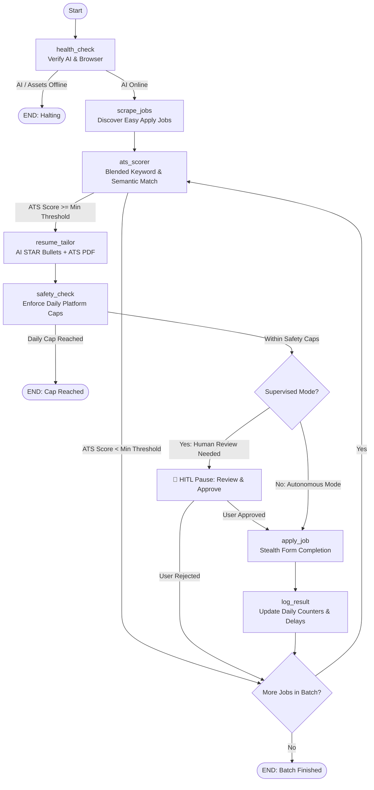

# 🎯 Autonomous Job Hunting Agent — LangGraph Architecture (v2.0)

<p align="center">
  
  
  
  
  
  
  
</p>

An intelligent, 100% free-tier autonomous job application system powered by **LangGraph StateGraph**, dual-engine AI orchestration (**Google Gemini** + **Local Ollama**), stealth browser automation, ATS keyword gap resolution, and Human-in-the-Loop review controls.

---

## 🌟 Key Features

- **🧠 Multi-Brain AI Orchestration**: Seamless zero-cost fallback chain:
  1. Google Gemini Free Tier (`gemini-2.5-flash`, 15 RPM / 1,500 requests per day)
  2. Local Ollama (`llama3.1:8b` for high-precision reasoning, `llama3.2:3b` for ultra-fast form extraction)
  3. Cloud Ollama backup via free Google Colab GPU (`ollama_server.ipynb` with ngrok)
- **📊 ATS Optimization Studio**: Dual-layer match engine calculating keyword frequency overlap blended with LLM semantic relevance. Identifies missing keywords and dynamically rewrites resume summaries and STAR bullet points.
- **📄 ReportLab ATS PDF Compiler**: Automatically compiles tailored resume markdown into clean, single-column, ATS-scannable PDFs attached directly to job application forms.
- **🥷 Stealth Browser Automation**: Playwright persistent session engine with fingerprint spoofing, human-like typing cadences, and randomized delays to bypass anti-bot detections.
- **🧑 Human-in-the-Loop (HITL) Review**: Safe supervised mode pauses the graph immediately before form submission, allowing you to review target company, job title, ATS score, and tailored bullets before approving.
- **🌐 Glassmorphic Real-Time Web Dashboard**: Real-time FastAPI + Server-Sent Events (SSE) web interface (`server.py`) at `http://127.0.0.1:8765` featuring live state machine visualization, job logs, and one-click approvals.
- **💻 Interactive Rich Terminal Console**: Comprehensive CLI (`cli.py`) with rich color-coded tables, diagnostics, manual application triggers, and system audits.
- **🛡️ Anti-Ban Safeguards & Platform Caps**: Enforces strict per-session limits, daily maximum quotas, and randomized 45–90 second delays between submissions.
- **📲 WhatsApp Desktop Job Alerts**: Direct notifications to your personal WhatsApp groups with formatted job cards and ATS match metrics.
- **⏰ 24/7 Autopilot Scheduler**: Native Windows Task Scheduler integration (`scripts/setup_scheduler.ps1`) to run background cycles every 3 hours automatically.

---

## 🧠 LangGraph StateGraph Architecture

The entire pipeline is governed by a cyclic, fault-tolerant state machine with SQLite persistence (`checkpoints/job_agent.db`):



---

## ⚡ Quick Start: 30-Second Launch

### Option A: Modern Web Dashboard (Recommended)

Launch the real-time visual Command Center:
```powershell
python server.py
```
Open **[http://127.0.0.1:8765](http://127.0.0.1:8765)** in your browser to view:
- Live LangGraph state transitions and status stream
- ATS match gauge and tailored resume previews
- One-click Human-in-the-Loop review approvals
- Application counters and safety progress rings

### Option B: Terminal Command Center

Launch the interactive terminal menu:
```powershell
python cli.py
```
- **Option 1**: Run System & AI Health Check (LangGraph StateGraph).
- **Option 2**: Run ATS Resume Matcher & AI Tailoring Engine.
- **Option 3**: Launch Stealth Browser for one-time LinkedIn/Indeed login.
- **Option 4**: Run Supervised Application Batch with **Human-in-the-Loop approval**.
- **Option 5**: Run Headless Application Batch (`runner.py`).
- **Option 6**: Observability & Checkpoint Inspector (LangSmith / SQLite DB).
- **Option 7**: Register Windows Task Scheduler for 24/7 background autopilot.
- **Option 9**: Launch Web Dashboard UI.

### Option C: Headless Autopilot Runner

Run a single autonomous cycle (used by Task Scheduler or background workers):
```powershell
python runner.py
```

---

## 🔧 Installation & Setup

### 1. Prerequisites
- **Python**: 3.11 or 3.12+
- **Git**
- **Ollama** (Optional for local offline AI): [Download Ollama](https://ollama.com)
- **Google Gemini API Key** (Free Tier): [Get free key at Google AI Studio](https://aistudio.google.com/apikey)

### 2. Clone the Repository
```powershell
git clone https://github.com/SouravGouda75/Job-Agent.git
cd Job-Agent
```

### 3. Create a Virtual Environment
```powershell
python -m venv .venv
.\.venv\Scripts\Activate.ps1
```

### 4. Install Dependencies
```powershell
pip install -r requirements.txt
playwright install chromium
```

### 5. Configure Environment Variables
Copy `.env.example` to `.env`:
```powershell
copy .env.example .env
```
Open `.env` and set your preferences:
```ini
# Google Gemini Free Tier Key
GEMINI_API_KEY=your_gemini_api_key_here
GEMINI_MODEL=gemini-2.5-flash

# Local Ollama URL
OLLAMA_BASE_URL=http://localhost:11434
OLLAMA_MODEL=llama3.1:8b
OLLAMA_FAST_MODEL=llama3.2:3b

# Target Roles & Locations
TARGET_ROLES=Generative AI Engineer,AI Engineer,Machine Learning Engineer,Software Engineer
TARGET_LOCATIONS=Remote,Hybrid,On-site
TARGET_CITIES=Hyderabad,Bangalore,San Francisco
```

### 6. Add Your Resume
Place your master resume in the `resumes/` folder in **PDF**, **DOCX**, or **Markdown** format (e.g. `resumes/My_Resume.pdf`). A generic sample resume (`resumes/sample_candidate_resume.pdf`) is included for instant testing.

### 7. One-Time Browser Login
Run `python cli.py` and choose **Option 3** (or run `python scripts/stealth_browser_agent.py --login`). A browser window will open:
- Log in to your LinkedIn / Indeed accounts.
- Your session cookies and credentials remain securely stored in your local `browser_profile/` folder (never uploaded or shared).

---

## 📁 Repository Structure

```
📁 Job-Agent/
├── 📄 cli.py                      ← Interactive Command Center (Rich terminal UI)
├── 📄 server.py                   ← FastAPI backend & SSE event hub for Web UI
├── 📄 runner.py                   ← Headless execution runner for Task Scheduler
├── 📄 pyproject.toml              ← Project package configuration & dependencies
├── 📄 requirements.txt            ← Pip requirements specification
├── 📄 .env.example                ← Environment template with configuration docs
├── 📄 .gitignore                  ← Strict rules protecting API keys, cookies & resumes
├── 📄 README.md                   ← Project documentation
├── 📁 src/                        ← Core application logic
│   ├── 📄 config.py               ← Centralized cached configuration manager
│   ├── 📄 state.py                ← TypedDict State schema & initial state builder
│   ├── 📄 llm.py                  ← Multi-Brain LLM (Gemini + Ollama fallback)
│   ├── 📄 graph.py                ← LangGraph StateGraph & checkpoint persistence
│   ├── 📁 nodes/                  ← LangGraph State Machine Nodes
│   │   ├── 📄 health_check.py     ← Verifies Ollama, Gemini, Playwright, assets
│   │   ├── 📄 scrape_jobs.py      ← Discovers Easy Apply jobs on LinkedIn/Indeed
│   │   ├── 📄 jd_prescreen.py     ← Analyzes job requirements vs candidate profile
│   │   ├── 📄 ats_scorer.py       ← Blended keyword & semantic ATS match scoring
│   │   ├── 📄 resume_tailor.py    ← AI STAR bullet generator & ATS PDF builder
│   │   ├── 📄 safety_check.py     ← Enforces platform daily limits & anti-ban rules
│   │   ├── 📄 apply_job.py        ← Playwright stealth form automation & submission
│   │   └── 📄 log_result.py       ← Execution logging & randomized pacing delays
│   ├── 📁 tools/                  ← Reusable tooling modules
│   │   ├── 📄 text_extractor.py   ← Extracts text from PDF, DOCX, TXT, MD
│   │   ├── 📄 pdf_builder.py      ← ReportLab ATS single-column PDF compiler
│   │   ├── 📄 browser.py          ← Playwright persistent stealth browser
│   │   └── 📄 whatsapp_desktop.py ← WhatsApp Desktop notification dispatcher
│   └── 📁 prompts/                ← Prompt templates
│       ├── 📄 resume_prompts.py   ← Prompts for summary & STAR bullet tailoring
│       └── 📄 screening_prompts.py← Prompts for application question answering
├── 📁 web/                        ← Web Dashboard frontend assets
│   ├── 📄 index.html              ← Glassmorphic dashboard UI
│   ├── 📄 style.css               ← Responsive modern design system
│   └── 📄 app.js                  ← Real-time SSE listener & StateGraph UI controller
├── 📁 scripts/                    ← Diagnostic & standalone automation scripts
│   ├── 📄 test_connections.py     ← Validates Ollama, Gemini, and system RAM
│   ├── 📄 check_models.py         ← Benchmarks available Gemini models
│   ├── 📄 test_whatsapp_group.py  ← Tests WhatsApp group notification dispatch
│   ├── 📄 match_resume.py         ← Standalone ATS scoring & tailoring tester
│   ├── 📄 setup_scheduler.ps1     ← Registers Windows Task Scheduler autopilot
│   └── 📄 run_cycle.ps1           ← PowerShell execution cycle script
├── 📁 job_descriptions/           ← Target job postings for matching & testing
├── 📁 resumes/                    ← Candidate resumes (PDF / DOCX / MD)
├── 📁 tailored_resumes/           ← Generated ATS markdown and PDFs
├── 📁 checkpoints/                ← SQLite state persistence database (job_agent.db)
└── 📁 logs/                       ← Structured execution logs & daily counters
```

---

## 🛡️ Anti-Ban Safeguards & Daily Caps

To protect your accounts from rate limits and automated detection, the system enforces safety caps inside `safety_check` and `log_result`:

| Platform | Max per Session | Daily Quota Cap | Action Delay | Run Frequency |
|---|---|---|---|---|
| **LinkedIn** | 5–10 | 40 applications / day | 45–90s randomized | Every 3 hours |
| **Indeed** | 5 | 25 applications / day | 60–120s randomized | Every 3 hours |
| **Glassdoor** | 3 | 20 applications / day | 90–150s randomized | Every 3 hours |

---

## ⚙️ Configuration Reference

| Environment Variable | Default Value | Description |
|---|---|---|
| `GEMINI_API_KEY` | *(Required)* | Google AI Studio Gemini API Key |
| `GEMINI_MODEL` | `gemini-2.5-flash` | Gemini model name for inference |
| `OLLAMA_BASE_URL` | `http://localhost:11434` | Ollama local endpoint or Colab ngrok URL |
| `OLLAMA_MODEL` | `llama3.1:8b` | Main Ollama model for tailoring |
| `OLLAMA_FAST_MODEL` | `llama3.2:3b` | Fast model for quick form extraction |
| `TARGET_ROLES` | `AI Engineer,...` | Comma-separated list of target job titles |
| `TARGET_LOCATIONS` | `Remote,Hybrid` | Search location filters |
| `TARGET_CITIES` | `Hyderabad,...` | Specific cities to filter |
| `MAX_APPLICATIONS_PER_CYCLE` | `10` | Max applications processed per cycle |
| `MIN_ATS_SCORE_TO_SHOW` | `25` | Minimum ATS percentage to trigger tailoring |
| `MAX_EXPERIENCE_YEARS` | `3` | Experience ceiling for auto-screening |
| `MIN_DELAY_SECONDS` | `45` | Minimum delay between applications |
| `MAX_DELAY_SECONDS` | `90` | Maximum delay between applications |
| `HEADLESS_MODE` | `False` | Run browser headlessly (`True`/`False`) |
| `WHATSAPP_ENABLED` | `false` | Enable desktop WhatsApp dispatch |
| `WHATSAPP_TARGET_GROUP` | `Job Alerts` | Target WhatsApp group title |

---

## 🧪 Diagnostics & Testing Scripts

Run standalone diagnostic tools anytime:

- **Test AI & Endpoint Connectivity**:
  ```powershell
  python scripts/test_connections.py
  ```
- **Benchmark Gemini Models**:
  ```powershell
  python scripts/check_models.py
  ```
- **Test Resume ATS Matching Standalone**:
  ```powershell
  python scripts/match_resume.py
  ```
- **Test WhatsApp Group Notifications**:
  ```powershell
  python scripts/test_whatsapp_group.py "Your Group Name"
  ```

---

## ⚠️ Disclaimer & Ethical Use

This software is developed strictly for personal educational and productivity purposes. Users are responsible for complying with the Terms of Service of any target job board or platform (LinkedIn, Indeed, Glassdoor). Always use human-like delays, adhere to reasonable daily application caps, and review applications using Human-in-the-Loop mode.

---

## 📄 License

This project is licensed under the [MIT License](LICENSE).
